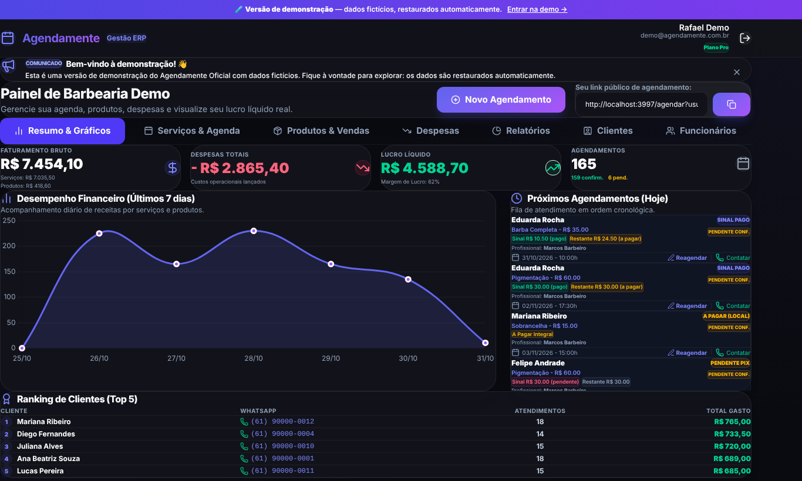
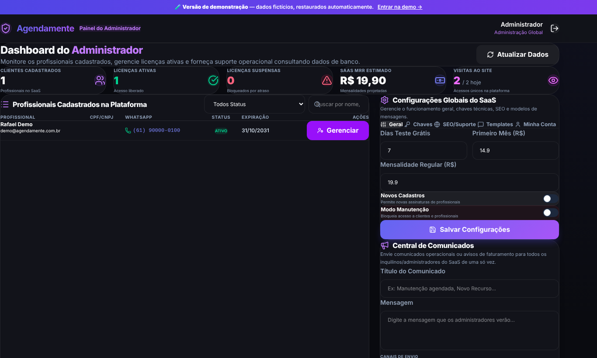
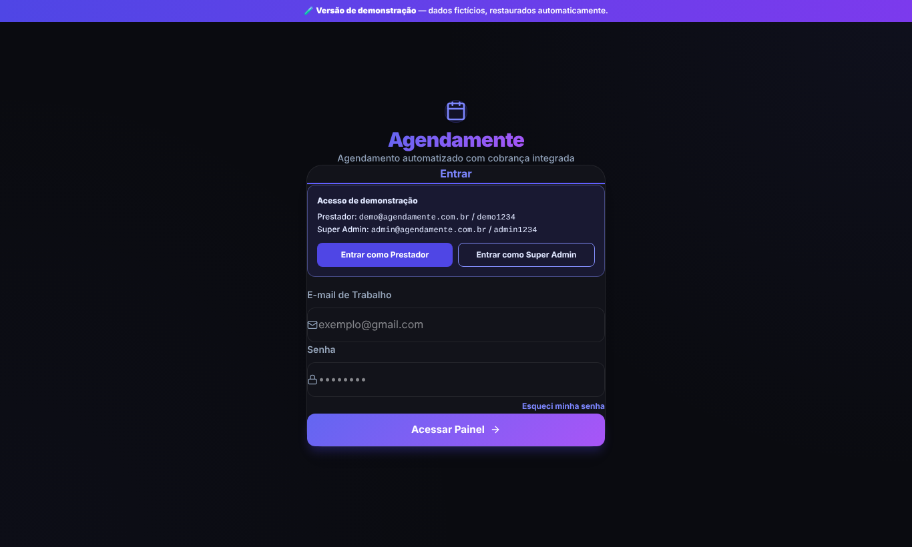

# 📅 Agendamente Oficial: Plataforma SaaS de Agendamento Online

[](https://nodejs.org/)
[](https://www.typescriptlang.org/)
[](https://expressjs.com/)
[](https://www.postgresql.org/)
[](https://tailwindcss.com/)
[](https://agendamente-oficial-demo.onrender.com)

> Plataforma SaaS **multi-tenant** de agendamento online, com cobrança de sinal via **Pix**, confirmação automática de pagamento por **webhook** e lembretes **anti-falta pelo WhatsApp**. Inclui painéis de gestão para o prestador (agenda, equipe, comissões, produtos, despesas e relatórios) e para o dono do SaaS (super admin).

O sistema operou em produção em **agendamenteoficial.com.br**. Este repositório traz o código-fonte e uma **versão de demonstração** com dados fictícios.

---

## 🧪 Demo online

**👉 [agendamente-oficial-demo.onrender.com](https://agendamente-oficial-demo.onrender.com)**

| Perfil | E-mail | Senha |
|---|---|---|
| Prestador (Barbearia Demo) | `demo@agendamente.com.br` | `demo1234` |
| Super Admin (dono do SaaS) | `admin@agendamente.com.br` | `admin1234` |

- **Página pública de agendamento (visão do cliente):** [`/agendar?usuarioId=1`](https://agendamente-oficial-demo.onrender.com/agendar?usuarioId=1)
- A tela de login tem botões de **acesso rápido** para cada perfil.
- Os dados são fictícios e **restaurados automaticamente** sempre que o servidor reinicia.
- Na demo, o WhatsApp roda em **modo simulação** (as mensagens aparecem no log do servidor) e o Pix é gerado localmente, com um botão para simular o pagamento.

> ⏳ A demo está hospedada em um plano gratuito, que "hiberna" quando fica sem acessos. O primeiro acesso pode levar até 1 minuto para carregar.

---

## 📸 Telas

| Painel do prestador | Agendamento pelo cliente (mobile) |
|---|---|
|  |  |

| Painel do Super Admin | Login com acesso de demonstração |
|---|---|
|  |  |

---

## 📌 O problema

Clínicas, barbearias, salões e prestadores de serviço perdem dinheiro com **agendamentos manuais** e **clientes que marcam e não aparecem**. O Agendamente automatiza o fluxo inteiro:

1. O cliente escolhe serviço, profissional e horário em um link público.
2. Paga um **sinal via Pix**. O pagamento é confirmado automaticamente por webhook do Mercado Pago.
3. Recebe **confirmação e lembretes no WhatsApp** e confirma a presença com um clique.
4. O prestador acompanha agenda, faturamento, comissões e lucro em um painel.

---

## ✨ Funcionalidades

**Para o cliente final**
- Agendamento online responsivo (PWA instalável), com escolha de serviço(s), profissional e horário
- Checkout Pix com QR Code e copia e cola
- Confirmação/cancelamento de presença por link enviado no WhatsApp

**Para o prestador**
- Dashboard financeiro: faturamento, despesas, lucro líquido e gráficos (Chart.js)
- Agenda visual com FullCalendar: reagendamento, agendamento manual e controle de presença
- Gestão de **equipe e comissões** por serviço, com controle de pagamento
- Controle de **produtos, estoque e vendas**
- Lançamento de **despesas** e relatórios gerenciais
- Histórico de clientes, ranking e isenção de sinal para clientes fiéis
- Conexão do próprio WhatsApp (QR Code via Evolution API) e da própria conta Mercado Pago (OAuth)

**Para o dono do SaaS (Super Admin)**
- Gestão de assinantes, licenças, vencimentos e suspensões automáticas
- Planos de assinatura com cobrança via Pix (Mercado Pago)
- Configurações globais: preços, período de teste, modo manutenção, SEO e templates de mensagens
- Envio de comunicados para todos os assinantes e métricas de visitas

---

## 🏗️ Arquitetura

```
┌──────────────────────┐      ┌────────────────────────────────────────┐
│  Frontend (PWA)      │      │  Backend: Node.js + Express + TS       │
│  HTML + JS + Tailwind│─────▶│                                        │
│  FullCalendar        │ REST │  routes → middlewares (JWT, super,     │
│  Chart.js            │◀─────│           demo guard) → controllers    │
└──────────────────────┘      │                         → services     │
                              │                                        │
                              │  services: pix · whatsapp/evolution ·  │
                              │  mail · scheduler · subscription check │
                              └───────┬───────────────┬────────────────┘
                                      │               │
                     ┌────────────────▼──┐   ┌────────▼───────────────┐
                     │ PostgreSQL /      │   │ Integrações externas   │
                     │ SQLite (camada    │   │ Mercado Pago (Pix,     │
                     │ de abstração)     │   │ webhooks, OAuth)       │
                     └───────────────────┘   │ Evolution API (WhatsApp│
                                             │ multi-instância), SMTP │
                                             └────────────────────────┘
```

**Destaques técnicos**
- **Multi-tenant:** cada prestador tem seus próprios serviços, equipe, agenda e clientes, isolados por `usuario_id`.
- **Camada de banco agnóstica:** o mesmo código roda em **PostgreSQL** (produção) ou **SQLite** (desenvolvimento/demo). Uma camada de tradução converte placeholders, funções de data e `RETURNING id` automaticamente.
- **Concorrência de horários:** validação no backend impede dois agendamentos no mesmo slot e profissional.
- **Pix EMV gerado no backend:** payload BR Code com CRC16 calculado manualmente, além da integração com a API de pagamentos do Mercado Pago e confirmação por webhook.
- **Rotinas agendadas:** verificação diária de assinaturas (avisos de vencimento e suspensão) e verificação horária de lembretes de agendamento.
- **Segurança:** autenticação JWT, senhas com bcrypt, middleware de autorização por perfil (prestador / super admin), modo manutenção e validações de entrada.

---

## 🛠️ Stack

| Camada | Tecnologias |
|---|---|
| Backend | Node.js, Express, TypeScript, JWT, bcrypt, Nodemailer, Multer |
| Banco de dados | PostgreSQL (produção), SQLite (desenvolvimento/demo) |
| Frontend | HTML5, JavaScript, Tailwind CSS, FullCalendar, Chart.js, Lucide Icons, PWA (Service Worker + Manifest) |
| Integrações | Mercado Pago (Pix, Webhooks, OAuth), Evolution API (WhatsApp multi-instância), SMTP |
| Infraestrutura | VPS Linux, Nginx, Docker (Evolution API), SSL. Demo no Render |

---

## 📂 Estrutura do projeto

```
├── backend/
│   ├── src/
│   │   ├── config/        # Conexão e migrações do banco (PostgreSQL/SQLite)
│   │   ├── controllers/   # Regras de negócio por recurso
│   │   ├── middlewares/   # Autenticação JWT e autorização Super Admin
│   │   ├── routes/        # Rotas REST da API
│   │   ├── services/      # Pix, WhatsApp, e-mail, rotinas agendadas
│   │   ├── demo/          # Modo demonstração (seed + bloqueio de ações)
│   │   ├── app.ts         # Configuração do Express
│   │   └── server.ts      # Inicialização do servidor e das rotinas
│   └── .env.example
├── frontend/
│   ├── admin/             # Painel do prestador e login
│   ├── super/             # Painel do Super Admin
│   ├── public/            # Agendamento, checkout e confirmação (cliente)
│   └── index.html         # Landing page
├── schema.sql             # Esquema de referência do banco
└── render.yaml            # Deploy da demo no Render
```

---

## 🚀 Como rodar localmente

**Pré-requisitos:** Node.js 20+

```bash
git clone https://github.com/Deividemak/agendamente-oficial.git
cd agendamente-oficial/backend
npm install
cp .env.example .env
```

**Opção 1: modo demonstração (mais rápido).** No `.env`, defina `DEMO_MODE=true` e rode:

```bash
npm run dev
```

Acesse `http://localhost:3000/admin-login` e use as credenciais de demo.

**Opção 2: modo normal.** Deixe `DEMO_MODE=false`, configure `SUPER_ADMIN_PASSWORD` e, se quiser, PostgreSQL (`DB_TYPE=postgres`), SMTP, Mercado Pago e Evolution API no `.env`. Integrações não configuradas rodam em modo simulação.

**Build de produção:**

```bash
npm run build
npm start
```

---

## 👨‍💻 Autor

**Deivide Ferreira de Souza**, Desenvolvedor Full Stack

- 💼 LinkedIn: [linkedin.com/in/deividmak](https://linkedin.com/in/deividmak)
- 🐙 GitHub: [@Deividemak](https://github.com/Deividemak)
- ✉️ E-mail: [deividmak@gmail.com](mailto:deividmak@gmail.com)
